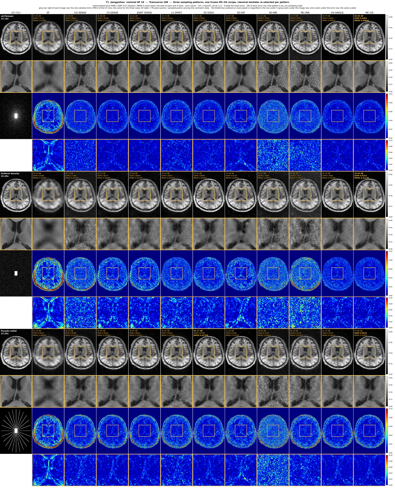
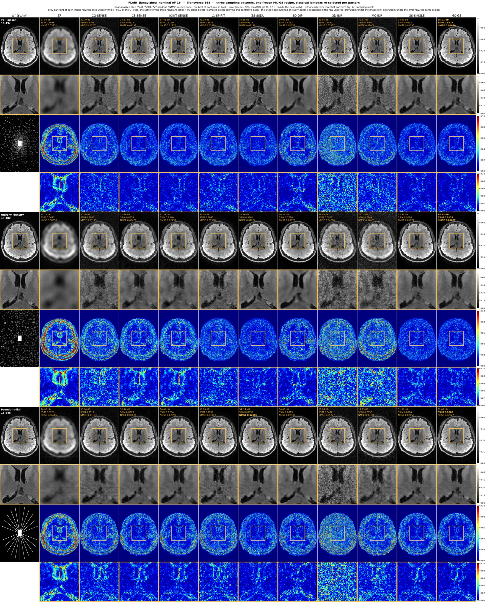
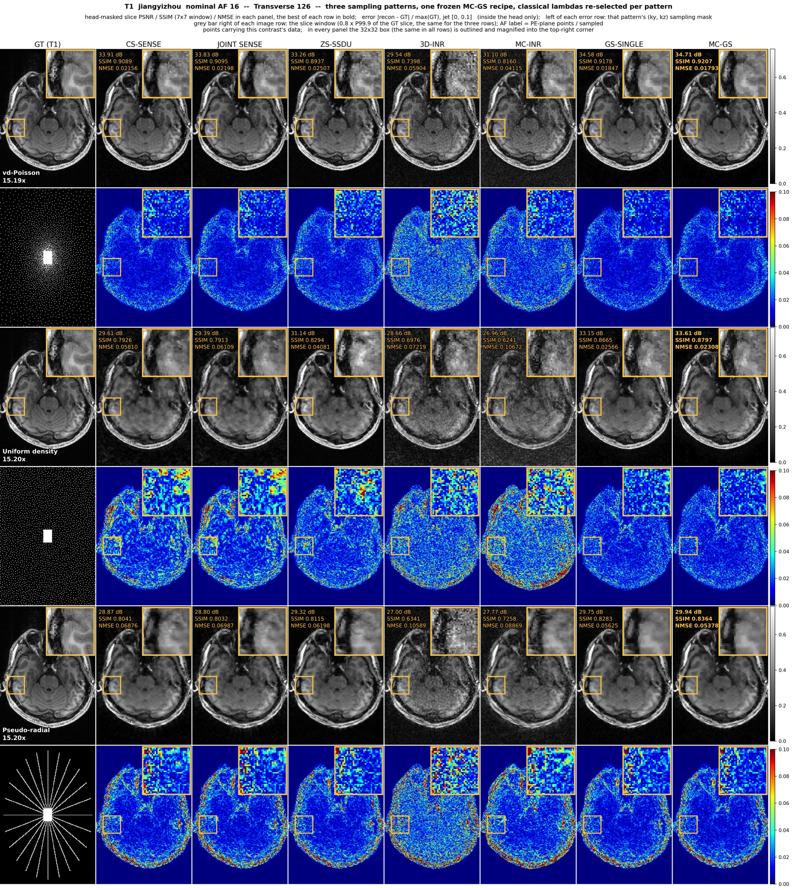
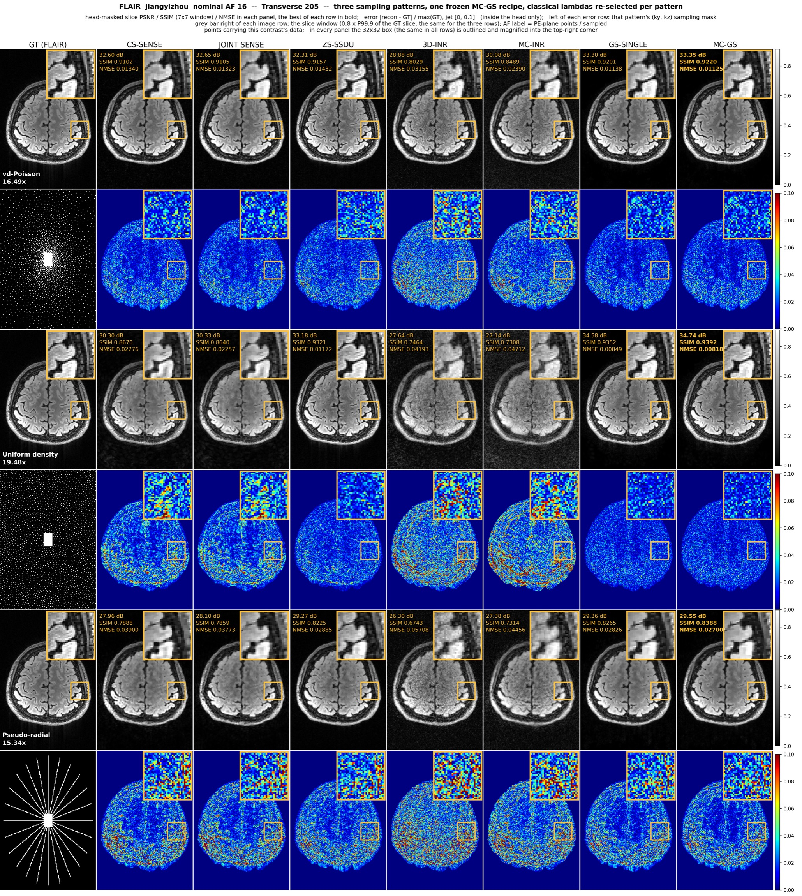

# Diff-mask study on jiangyizhou T1 + FLAIR, nominal AF 16: the three sampling patterns, redone (2026-11-11)

**Status (2026-11-12 20:50 PST): the redone study is final.** The three masks were approved by the user on 2026-11-11 (about 21:00 PST) from
`preview/masks_af16_redo_preview.png`. **Row 2 (uniform density) is complete**: every arm of the September study, both
contrasts, in the new topic `Results_20260908/T1FLAIR_AF16_uniform_v3_jiangyizhou`; MC-GS on the frozen recipe is
first on head PSNR, head SSIM and head HFEN on T1 and on FLAIR, and the study's table and three-pattern figures are
redrawn with it as row 2 (sections "Row 2 reconstructed" and "The study with the new row 2"). Row 1 is the house
mask and is not re-run (`T1FLAIR_AF16_v3_jiangyizhou`). **Row 3 keeps the September pseudo-radial result** (user,
2026-11-12 20:48 PST: "the radial direction still uses the old result"): the two radial masks drawn on 2026-11-11
are not reconstructed and not used. So the study is vd-Poisson (house) / uniform density (new) / pseudo-radial
(September, `T1FLAIR_AF16_radial_v3_jiangyizhou`).

## Why

The September diff-mask study (server worktree `/data0/congcong/code/GS/mcgs_diffmask_wt`, topics
`Results_20260908/T1FLAIR_AF16_{gauss,radial}_v3_jiangyizhou`, GitHub branch `jyz-af16-diffmask`) compared three rows:
the house vd-Poisson mask, a Gaussian variable-density random mask, and a Cartesian pseudo-radial mask that carried the
24 x 16 ACS block. On 2026-11-11 the user said these three masks were not the intended ones and asked for:

1. the vd-Poisson mask at AF 16;
2. a mask whose centre ACS is fully sampled and whose other points are spread over k-space without a density that
   rises towards the ACS, then (second instruction, same day) "re-generate the second mask from the ESPIRiT tool in
   Michael Lustig's work";
3. the conventional radial mask.

## The masks

PE plane (ky, kz) = (256, 176), DC at (128, 88). AF = PE-plane points / sampled points that carry that contrast's data
(user definition, 2026-09-14). T1 acquires the whole plane; FLAIR's vendor shutter leaves 34139 of 45056 points.

| row | mask | how | points | T1 AF | FLAIR AF | points outside FLAIR's shutter | fully sampled centre (ky x kz) |
|---|---|---|---|---|---|---|---|
| 1 | vd-Poisson disc | the house AF16 mask, unchanged: `vdPoisMex(256,176,256,176, 4, 4, 24, 0, 1)` | 2966 | 15.19 | 16.49 | 233 | 24 x 16 |
| 2 | uniform density + ACS | the same generator with `pp = 0`: `vdPoisMex(256,176,256,176, 4.1979, 4, 24, 0, 0)` | 2964 | 15.20 | 19.48 | 651 | 24 x 16 |
| 3 | conventional radial | 16 full-diameter spokes through DC, every 11.25 deg, one point wide, no ACS block | 2964 | 15.20 | 15.45 | 48 | 14 x 6 |
| (3 alt) | radial + ACS | 15 spokes every 12 deg plus the 24 x 16 block | 2964 | 15.20 | 15.46 | 49 | 24 x 16 |

- **Row 1** is read from `Results_20260908/T1FLAIR_AF16_v3_jiangyizhou/data/mask_vdpois_256x176_af16.mat`
  (md5 `2d7ed0001214aec2af8f6dce5d52ce70`), not regenerated.
- **Row 2** comes from `vdPoisMex` in Michael Lustig's ESPIRiT toolbox (`/data0/congcong/code/ESPIRiT/utils`, the
  compiled mex, not rebuilt). `pp` is the polynomial order of the variable density; the toolbox's help says
  "0 = uniform". Everything else is the house call. The budget is the September study's, exactly 2964 points:
  `accelx` was fitted on ten draws (n = 353.1 + 10960.3 / accelx, so 4.1979) and draws were repeated until the first one
  with exactly 2964 points, draw 43, taken untrimmed and chosen by its point count alone
  (`preview/mask2_vdpoismex_pp0_draws.txt`). The points still keep the generator's minimum spacing: it is a
  uniform-density Poisson-disc pattern, not an i.i.d. random one. `vdPoisMex` seeds from `time(0)`, so this mask
  **cannot be regenerated bit for bit**; the saved file is the record.
- **Row 3** has angles uniform in normalised k-space (same k-max in ky and kz), equal-length spokes, one sample per step
  along each spoke's major axis. 16 is the smallest spoke count that reaches the budget; the 143 excess points are
  removed at the spoke tips, so every spoke ends at normalised radius 0.957. Deterministic.

The first version of row 2 in this session was an i.i.d. uniform random draw in numpy (2964 points, FLAIR 19.38x). The
user replaced it with the ESPIRiT-toolbox mask above; it is not kept.

## Row 2 reconstructed (uniform density), 2026-11-11 / 12

User request, 2026-11-11 22:05 PST: reconstruct on the uniform-density mask; "the core objective is for MCGS to
outperform all the comparison methods"; afterwards "the old uniform density experimental results should be replaced".
The row it replaces is the September row 2, the Gaussian variable-density topic (confirmed by the user on 2026-11-12
20:48 PST); the replacement is made in the study's figures and tables, and the September topic stays on disk.

**Design: one variable.** Exactly as in September, the only thing that differs from `T1FLAIR_AF16_v3_jiangyizhou` is
the mask pattern: same k-space, ESPIRiT maps, ground truth, gauge (scale = P99.9 of |GT|, 99.25055 on T1), scorer
(head PSNR / SSIM / HFEN), the same arms with the same arguments, and MC-GS / GS-single on the **frozen AF16 phase-3
recipe** (`run_diffmask_mcgs.sh`'s argument list; `run_uniform.py` asserts it equals the recorded argv of the September
Gaussian-mask runs, argument for argument). Nothing was tuned for MC-GS on this mask.

**Result** (head-masked metrics on the magnitude gauge; swept arms at their best lambda by head PSNR, the September
rule; `uniform_recon/standings.txt` has the whole-volume columns too):

| arm | T1 head PSNR | SSIM | HFEN | FLAIR head PSNR | SSIM | HFEN |
|---|---|---|---|---|---|---|
| **MC-GS (joint)** | **34.903** | **0.9151** | **0.2178** | **34.984** | **0.9166** | **0.2079** |
| GS-single | 34.396 | 0.9042 | 0.2443 | 34.842 | 0.9134 | 0.2196 |
| ZS-SSDU | 32.274 | 0.8794 | 0.3245 | 34.221 | 0.9161 | 0.2404 |
| L1-SPIRiT (ks 5, lambda 0.001) | 32.732 | 0.8667 | 0.2897 | 33.823 | 0.8859 | 0.2444 |
| CS-SENSE, TV converged (lambda 0.0014) | 30.924 | 0.8470 | 0.3989 | 32.072 | 0.8659 | 0.3602 |
| joint CS-SENSE, JTV (lambda 0.002) | 30.755 | 0.8456 | 0.3976 | 32.075 | 0.8652 | 0.3602 |
| CS-SENSE (base, 35 outer iterations) | 30.361 | 0.8352 | 0.4252 | 31.929 | 0.8648 | 0.3673 |
| 3D-DIP | 29.894 | 0.7902 | 0.4563 | 30.046 | 0.7930 | 0.3761 |
| 3D-INR | 29.491 | 0.7555 | 0.4716 | 29.312 | 0.7354 | 0.4923 |
| CG-SENSE | 28.561 | 0.7709 | 0.5105 | 30.781 | 0.8221 | 0.4529 |
| MC-INR | 27.671 | 0.6715 | 0.5774 | 29.642 | 0.7519 | 0.5047 |
| ZF | 24.408 | 0.5654 | 0.8697 | 26.264 | 0.6155 | 0.8447 |

- **MC-GS is first on all three head metrics on both contrasts.** Runner-up on head PSNR is GS-single: **+0.507 dB**
  on T1, **+0.142 dB** on FLAIR (September, Gaussian mask: +0.138 / +0.023). Over the best arm that is not a Gaussian
  model: +2.17 dB on T1 (L1-SPIRiT), +0.76 dB on FLAIR (ZS-SSDU).
- **The thinnest lead is FLAIR head SSIM over ZS-SSDU: 0.9166 against 0.9161 (+0.0005).** That is a tie in practice.
- **Whole-volume SSIM (background included) is higher for ZS-SSDU** (T1 0.9278 against 0.9034, FLAIR 0.9477 against
  0.9077). The study's gauge is the head-masked one, as in September; the whole-volume numbers are in the standings.
- The uniform density is much harder for the classical arms than the Gaussian mask was (CG-SENSE on T1 28.56 against
  31.90, converged TV 30.92 against 33.90), and hardly harder for the Gaussian models (MC-GS on T1 34.903 against
  34.909). MC-GS's head SSIM and HFEN are worse than on the Gaussian mask (0.9151 / 0.2178 against 0.9333 / 0.1344).
- FLAIR runs at 19.48x on this mask (651 of the 2964 points fall outside its shutter), as noted under the masks.

**The lambda grids had to be extended upward.** On the September grids the converged-TV and joint-TV sweeps were
still rising at the top (T1 TV at 0.0014, FLAIR TV at 0.001, JTV at 0.0014), so those arms would have been scored
below their optimum. Points were added until every winner sat inside its grid: TV to 0.0056 (T1) and 0.008 (FLAIR),
JTV to 0.0056. Winners: TV 0.0014 on both contrasts, JTV 0.002, L1-SPIRiT 0.001 with the 5x5 kernel (its September
grid, 2 kernels x 6 lambdas, already brackets it). 65 jobs in all, no failure.

**How it was run.** Everything on the server went through `run_uniform.py` as `gpu.py` jobs (one GPU, card 7,
2026-11-11 22:49 to 2026-11-12 11:58 PST):

| mode | what |
|---|---|
| `--setup` | creates the topic: data links, the approved mask as a byte copy (md5 checked) and its 3-D broadcast, the per-topic scripts and configs ported from the Gaussian topic. The porting rule is proved first: applied with kind = radial it reproduces the radial topic's 30 scripts byte for byte |
| `--worker` | the queue: the September job list and arguments; `--add` extends a sweep or adds a run that leaves the frozen recipe (`gstune:`, not used), `--first` reorders. One job per card, only while no other compute process is on it |
| `--table` | standings from whatever has finished, flags a sweep winner that sits on the edge of its grid |
| `--finalize` | the September `finalize_diffmask.sh`: register the GS arms, summary, README tables, three-plane figures |
| `--study` | ports the seven cross-pattern scripts so that row 2 is "Uniform density", writing into the new topic and `~/figs/t1flair_v3_af16_diffmask_redo`; the September files are not touched |
| `--check_ext` | proves that starting the trainer compiles nothing (below) |

MC-GS and GS-single run in place in the September worktree `/data0/congcong/code/GS/mcgs_diffmask_wt` (HEAD 246e833,
clean), outputs `results_arc/af16u_p3_{joint,singleT1,singleFLAIR}_full4k*`. **Trap:** the trainer's start runs ninja
on the CUDA voxelizer, and the September `build.ninja` names `/usr/local/cuda-12.6/bin/nvcc`; an environment whose
`nvcc` resolves through `/usr/local/cuda` rewrites that file and recompiles inside the September worktree.
`run_uniform.py` puts `/usr/local/cuda-12.6/bin` first on `PATH` and refuses to start a trainer unless a dry run on a
private copy of the build directory changes no file. Every file in the build directory still carries its
2026-09-15 timestamp (checked after the last run).

### The study with the new row 2

The seven cross-pattern scripts of the September study were ported into the new topic (`run_uniform.py --study`):
row 2 reads the uniform-density topic, output goes to that topic and to `~/figs/t1flair_v3_af16_diffmask_redo/`.
**No file of the September topics was changed or deleted** (checked: no file in the Gaussian or pseudo-radial topic is
newer than 2026-11-11). The "old" row 2 is the September Gaussian variable-density row (confirmed by the user,
2026-11-12 20:48 PST).

Head PSNR, MC-GS against the strongest other arm (`uniform_recon/compare_masks_head_psnr.md`; SSIM and HFEN beside it):

| contrast | pattern | MC-GS | strongest comparison arm | margin |
|---|---|---|---|---|
| T1 | vd-Poisson (house) | 35.706 | GS-single 35.558 | +0.148 |
| T1 | **uniform density (new row 2)** | **34.903** | GS-single 34.396 | **+0.507** |
| T1 | pseudo-radial (September) | 31.113 | GS-single 30.913 | +0.200 |
| FLAIR | vd-Poisson (house) | 34.928 | GS-single 34.886 | +0.042 |
| FLAIR | **uniform density (new row 2)** | **34.984** | GS-single 34.842 | **+0.142** |
| FLAIR | pseudo-radial (September) | 31.729 | ZS-SSDU 31.635 | +0.093 |

The row it replaces (September, Gaussian variable density): T1 34.909, +0.138; FLAIR 34.317, +0.023.

Against the house mask the uniform density costs the regularised SENSE arms 2.0 to 4.1 dB (converged TV -4.02 on T1,
-2.23 on FLAIR) and the Gaussian models almost nothing on FLAIR and about 1 dB on T1 (MC-GS -0.80 / +0.06, GS-single
-1.16 / -0.04).

**Three-pattern figures.** The September slices and boxes were kept, not re-selected: T1 transverse 126 with the
32 x 32 box at (146, 29), FLAIR transverse 205 with the box at (148, 146), seven-method cut of 2026-09-18. With the new
row 2 they were checked only: MC-GS is first on box PSNR and box SSIM in all three rows of each figure (smallest box
lead +0.225 dB on T1, +0.142 dB on FLAIR), and first over every column on the whole slice. Slices and boxes were
selected on these data, so the whole-volume numbers are the ones to quote. The seven-method cut drops L1-SPIRiT, the
strongest non-Gaussian arm on T1 on this mask (32.73 dB); it is in the twelve-column figures and in the tables.

**Butterfly slice, all nine comparison methods (user request, 2026-11-12 18:45 PST).** Transverse 168, the house
butterfly slice of this subject, whole slice, twelve columns (GT, ZF, CG-SENSE, CS-SENSE, Joint SENSE, L1-SPIRiT,
ZS-SSDU, 3D-DIP, 3D-INR, MC-INR, GS-single, MC-GS), three patterns; the 64 x 64 box on the lateral ventricles at
(J, K) = (128, 88) is magnified under every image row and error row. The box is the bounding box of the ventricles
read from the ground truth (`butterfly_probe.py`, `uniform_recon/butterfly_probe.json`), not chosen by a score.
Inside the box MC-GS is first on PSNR and SSIM in all six rows (T1 +0.306 / +0.829 / +0.403 dB, FLAIR +0.079 /
+0.237 / +0.298 dB over the best other arm). On the whole slice it is first on the vd-Poisson and uniform-density
rows; **on the September pseudo-radial row ZS-SSDU has the better slice PSNR and NMSE** (T1 32.17 against 31.96 dB,
FLAIR 32.12 against 32.07 dB), MC-GS the better SSIM.





The seven-method figures of 2026-09-18 with the new row 2:





Where the full-resolution files are: on the server in the topic's `figures/` (PNG and PDF; served copies in
`~/figs/t1flair_v3_af16_diffmask_redo/` and `~/figs/t1flair_v3_af16_diffmask_uniform/`); on the Mac in
`uniform_recon/figures/` (git-ignored: 12 to 23 MB each, they would also break the `gpu.py` snapshot limits) and as
`../results/masks_{T1,FLAIR}_af16.png` (twelve columns) and `masks_{T1,FLAIR}_af16_sel7.png`; the September figures
those two names used to hold are kept beside them as `masks_{T1,FLAIR}_af16_sept_gauss.png`. The topic's own README
(`uniform_recon/TOPIC_README.md`, installed with `--readme`) has the per-topic tables and every check.

## Notes on the masks

- **Row 3: closed, the old result stays** (user, 2026-11-12 20:48 PST). The conventional-radial mask and its ACS
  variant in the table above were approved as drawings on 2026-11-11 but are not part of the study; the question
  "ACS block or not" no longer needs an answer. Should they ever be run: pure spokes leave a 14 x 6 fully sampled
  centre, and L1-SPIRiT calibrates its kernel from the mask's fully sampled centre block (`recon_spirit.py`,
  `acs_box()`), which was 24 x 16 in every earlier topic.
- **FLAIR sits at 19.48x on row 2**, against 16.49x on row 1: a uniform density spends 651 points in the corners FLAIR
  never acquires. Reported, not tuned, as in the September study.
- A full-diameter spoke is point-symmetric: every sampled point of row 3 has its conjugate partner sampled too.

## Files

| file | what |
|---|---|
| `make_masks_preview.py` | reads row 1, calls the MATLAB script for row 2, draws row 3 and its variant, writes the figure, the masks and the read-out to `$MCGS_ARTIFACT_DIR` |
| `gen_mask2_vdpoismex_pp0.m` | row 2: the `vdPoisMex` draws (output directory from `MASK2_OUT`) |
| `run_uniform.py` | row 2: setup of the topic, the reconstruction queue, standings, finalize, study-level port (section "Row 2 reconstructed") |
| `uniform_recon/standings.txt`, `.json` | every arm on the uniform-density mask, both contrasts (job `j-20261113T014134-062d8b41`) |
| `uniform_recon/summary.tsv` | the topic's summary as `summarize.py` wrote it (24 rows) |
| `uniform_recon/compare_masks_head_{psnr,ssim,hfen}.md` | every arm on the three patterns with the new row 2 |
| `uniform_recon/TOPIC_README.md` | the README installed in the server topic |
| `butterfly_probe.py`, `uniform_recon/butterfly_probe.json` | ground-truth slices with (J, K) grid lines and the ventricles' bounding boxes, used to place the butterfly box |
| `uniform_recon/preview/*.jpg` | reduced copies of the three-pattern figures (seven-method cut) and of the topic's three-plane figures |
| `preview/masks_af16_redo_preview.png` | the figure the user approved |
| `preview/masks_af16_redo_preview.json` | every number quoted above, with md5 sums |
| `preview/mask2_vdpoismex_pp0_draws.txt` | all 43 draws of row 2 with their point counts |

Run (CPU, about two minutes; it draws a NEW row 2, so do not use it to "restore" the approved one):

```sh
/usr/bin/python3 ../gpu-tools/gpu.py run --cpu -- @python autoresearch/diffmask_af16_masks_20261111/make_masks_preview.py
```

The masks themselves are not in git (`*.mat` is ignored). Approved files, job `j-20261112T035450-6ed722ac`, source
digest `24b6d0dc591f7bf381cf9b09a81675351b6789a03dc683b4449d4e2a4794de54`, kept read-only on the server in
`/home/congcongliu/codex_artifacts/mcgs_diffmask_af16_redo_20261111/` (key `mask`, (256, 176)):

| file | md5 |
|---|---|
| `mask_vdpoismex_pp0_256x176_af16_preview.mat` (row 2) | `d0796ac1a198ae2aba8983146b3830fc` |
| `mask_radial_256x176_af16_preview.mat` (row 3) | `a18824d8448161b687ccfd8ae06e3321` |
| `mask_radial_acs_256x176_af16_preview.mat` (row 3 variant) | `25de9fa0b6aee01a3d179f5fb77b2e97` |
