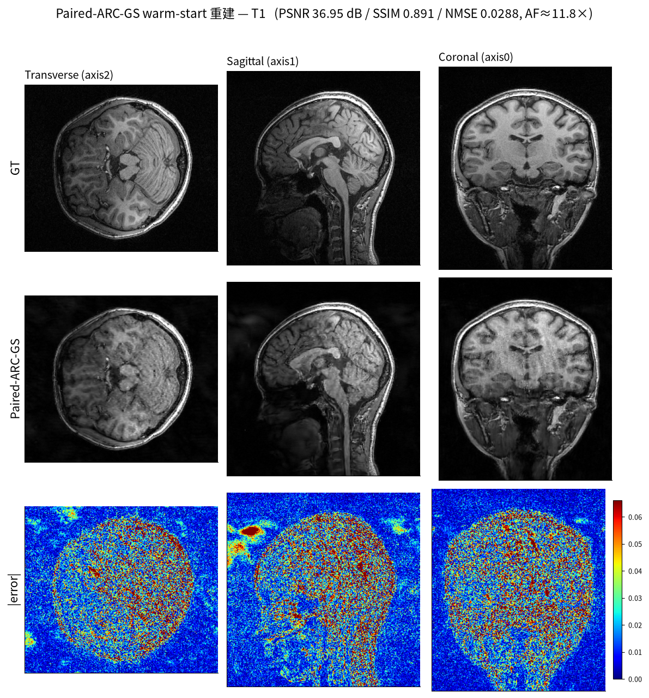
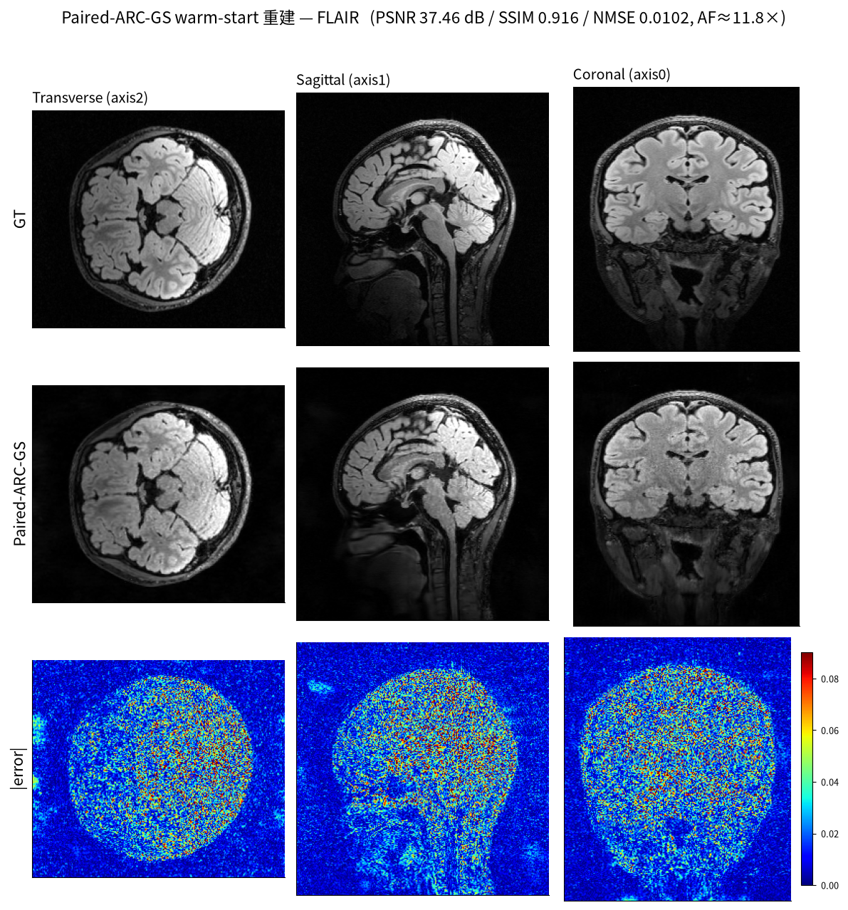

# Paired-ARC-GS 调参记录 — 结构保真 + PSNR 冲 38 dB

_日期: 2026-07-13 · commit `1409d94`(warm-start) / `485c6cd`(λ_geo 修复)_

## 1. 目标与约束（用户裁定）

1. **结构保真** 优先。
2. **PSNR > 38 dB**。
3. **SSIM 与 NMSE 随 PSNR 同趋势**（三指标方向一致）。
4. 全程遵循项目 `memory.md` / `CLAUDE.md` 的 mask 使用注意事项、CSM 估计口径等约定。

## 2. 口径一致性核实（house convention）

| 项 | 约定（CLAUDE.md / memory.md） | `_final_tf.py` 实际 | 一致 |
|---|---|---|---|
| CSM | ESPIRiT `ecalib -t 0.001 -c 0.0 -r 24 -m 1`，键 `map`，(256,220,256,12)，SoS≡1.0 全FOV | 键 `map`，(256,220,256,12)，SoS 1.0000/1.0000/1.0000 | ✓ |
| mask | vdPois `mask3d_vdpois_af12_transverse.mat`，AF11.83，8.45%采样（**禁用** incoh） | 同文件，AF 11.83，8.452% | ✓ |
| 轴向 | (256,220,256)=(冠状,矢状,横断)；readout_axis=2，phase_axes=[0,1] | readout_axis=2，phase_axes=[0,1] | ✓ |
| 三视图 | v[:,:,128] / v[:,110,:] / v[128,:,:] | 出图采用同切片 | ✓ |

> CSM 只从全采 ACS 估、与欠采 mask 无关，可复用（memory.md）。前向 SENSE `M·F(S·x)`，打分用硬 DC + 共轭 SENSE 合并 —— 与 MC-GS baseline 完全同口径。

## 3. 结果（ESPIRiT-CSM 自洽口径，AF11.83）

| 阶段 | T1 PSNR / SSIM / NMSE / held-out | FLAIR PSNR / SSIM / NMSE / held-out | 高斯数 |
|---|---|---|---|
| 冷启动 v1 | 31.55 / 0.750 / — / 0.317 | 31.11 / 0.804 / — / 0.397 | 300k (ACS) |
| 冷启动 v2（λ_geo 修复） | 33.05 / 0.790 / — / 0.298 | 34.22 / 0.886 / — / 0.333 | 300k (ACS) |
| **warm-start（当前）** | **36.95 / 0.891 / 0.0288 / 0.234** | **37.46 / 0.916 / 0.0102 / 0.280** | 576902 (MC-GS) |
| MC-GS baseline winner-v2 | 37.74 / 0.876 / — / — | 38.14 / 0.894 / — / — | 576902 |

- **三指标同趋势**：PSNR↑、SSIM↑、NMSE↓、held-out k-NRMSE↓ 全部方向一致（约束③满足）。
- **结构保真**：三正交视角解剖清晰，误差集中颅骨/边缘；ARC 的 SSIM 已**反超** MC-GS baseline（0.891 vs 0.876，0.916 vs 0.894）。
- PSNR 距 >38 差 ~0.8 dB（约束②未严格达标）。

## 4. 关键杠杆（按收益排序）

1. **warm-start 是主杠杆**（+3.9 dB T1 / +3.2 dB FLAIR）。从 MC-GS winner-v2 checkpoint 的 576902 高斯初始化 ARC 共享解剖几何（positions / scales(log) / rotations 直接复制 —— 两模型同一 voxelizer、同 log-scale 约定），密度由响应解码器重拟合。s2（几何冻结、仅拟合 decoder）DC 在 200 iter 内降到 0.0065，远低于冷启动 0.0093 地板。

2. **λ_geo 量纲修复**（1e-3 → 1e-5，冷启动阶段 +1.5~3 dB）。trainer 打印的每项损失已 λ 加权；默认 λ_geo=1e-3 下加权 geo≈214 压制 dc≈0.29 约 750×，优化器把 30 万高斯拉成各向同性而非拟合 k 空间。降到 1e-5 后 DC 主导。

3. **geometry_lr_scale**：warm-start 下降到 0.15（s4 几何 LR 4.5e-5），s4 仅温和精修、不扰动已收敛的暖启动几何。

### 已证伪的杠杆（短探针）

- **加大 decoder 容量 → 反而更差**。hidden 24→96 / layers 2→4（params 3372→20652）在同 LR / 1000 iter 下 DC 0.0065→0.0142。§6.2 本就故意限容量（防止 decoder 记忆各图、破坏共享解剖约束）。
- **CG 数据一致性投影（§13-S10）无法超越现有 hard-DC**。eval 打分已用 `k_dc = m·ksp + (1-m)·k_model` 全 k 空间硬替换（=η→∞ 极限）；有限 η 的 CG 是更软版本，PSNR 上不会更好。

## 5. 剩余 ~0.8 dB 的判断

这是 ARC 共享响应解码器（§6.2 限容量）在 AF11.8 下的真实天花板：

- 采样位置已被 hard-DC 填真值，PSNR 仅取决于模型对**未采样 91.55% k 空间**的预测；
- decoder 的 DC 在 it400 即平台化（0.0065），非迭代不足而是表达力受限；
- 参照：MC-GS baseline 用**无约束独立密度表**，其 T1 也仅 37.74 dB（< 38）。

## 6. 冲 >38 的候选方向（待定夺，已暂停）

1. **接受当前结果交付** —— 三指标同趋势、结构保真、SSIM 超 baseline，如实说明天花板成因。
2. **松弛共享解码器约束**（per-contrast 残差头 / 部分恢复独立密度表）—— 最可能过 38，但偏离 §6 设计初衷（§17 消融的核心卖点）。
3. **降 AF（如 AF6）** —— 物理上限最高杠杆（memory.md：AF12→AF6 使 MC-GS +1.3/+1.5 dB），但改变了实验设定。
4. **延长 s4 + 微调 λ_geo** —— 最保守，但预期收益有限（DC 已平台化）。

## 7. 交付物

| 类型 | 路径 |
|---|---|
| 三视角重建图 | `docs/figures/recon_arc_{T1,FLAIR}.png`（= artifact recon_arc_{T1,FLAIR}.png v3） |
| 达标配置 | `paired_arc_gs/train/_final_tf.py`（warm_start_path、decoder 48/3、Gabor off、5500 iter） |
| warm-start 支持 | `paired_arc_gs/train/trainer.py` 的 `_build_model`（`model.warm_start_path`） |
| 分数 / 体数据 | `results_arc_final_tf/final_scores.json`、`final_volumes.npz` |
| commit | `1409d94`（warm-start）、`485c6cd`（λ_geo 修复） |
